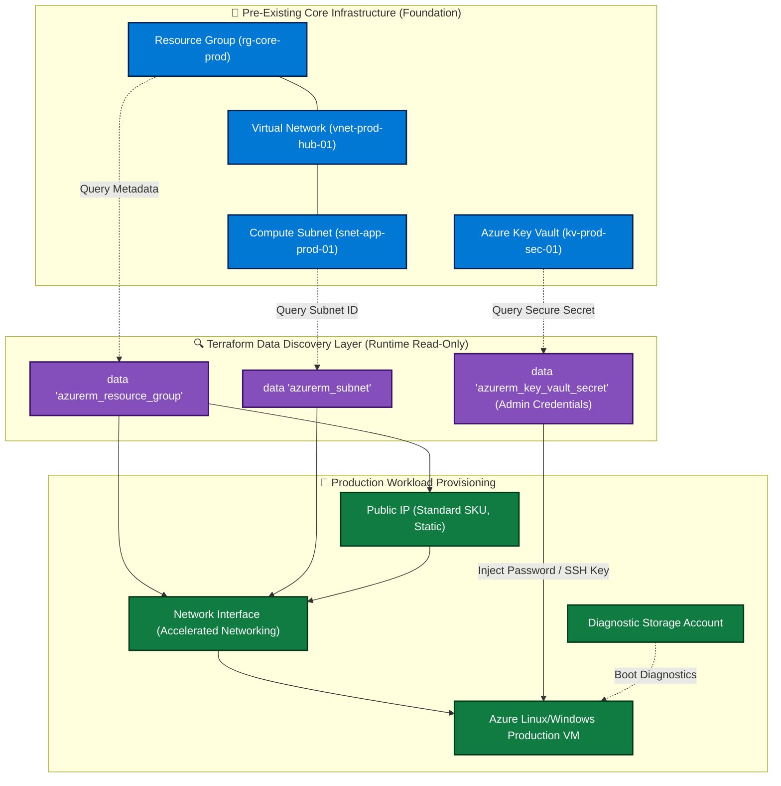

# 🏢 Production Azure Infrastructure with Terraform Data Blocks

[](https://azure.microsoft.com/)
[](https://www.terraform.io/)
[](https://azure.microsoft.com/)
[](LICENSE)

---

## 📌 Executive Overview

This repository demonstrates **enterprise-grade production infrastructure provisioning** using Terraform **Data Sources (`data` blocks)** to safely decouple foundational networking from application compute workloads. 

By querying existing core resources (Resource Groups, Virtual Networks, Subnets, and Key Vault secrets) dynamically at runtime, teams avoid tight state coupling, eliminate blast radius risk, and strictly follow the **Principle of Least Privilege**.

---

## 🏛️ Production Architecture & Provisioning Flow



---

### 🔍 Architectural Walkthrough & Component Explanation

1. **Foundational Decoupling (`Core Infrastructure`):**
   * Foundational infrastructure (Hub VNets, routing tables, corporate Key Vaults) is maintained in separate states to prevent accidental modification or teardown during application deployments.

2. **Dynamic Discovery (`Data Layer`):**
   * Terraform reads existing subnet IDs and resource attributes dynamically using `data "azurerm_subnet"`.
   * **Zero hardcoded resource IDs:** Configurations adapt seamlessly between regions and subscriptions.

3. **Zero Plaintext Secrets:**
   * Administrative passwords and SSH private keys are never stored in source code or `.tfvars`.
   * Terraform queries secrets securely from **Azure Key Vault** at execution time and injects them into the compute instance.

4. **Production Resiliency:**
   * Provisioned Network Interfaces (NICs) leverage **Accelerated Networking** for sub-millisecond network latency.
   * VMs are configured with standard static Public IPs, Network Security Group association, and managed boot diagnostics.

---

## 🚀 Deployment Guide

### 1. Prerequisites
* Azure CLI authenticated (`az login`) with active subscription.
* Existing Virtual Network and Subnet provisioned.
* Access to Azure Key Vault with `Key Vault Secrets User` role assigned to the executing Service Principal.

### 2. Execution
```bash
# Initialize Terraform
terraform init

# Validate configuration
terraform validate

# Plan against target environment
terraform plan -var-file="terraform.tfvars" -out=prod.tfplan

# Apply changes
terraform apply prod.tfplan
```

---

## 👨‍💻 Author

**Md Irshad Alam**  
*Senior Azure DevOps Engineer & Multi-Cloud Platform Architect*  
* 💼 **LinkedIn:** [linkedin.com/in/md-irshad-alam-0a5278220](https://www.linkedin.com/in/md-irshad-alam-0a5278220)  
* 📬 **Email:** `mdirshadalam91190@gmail.com`  
